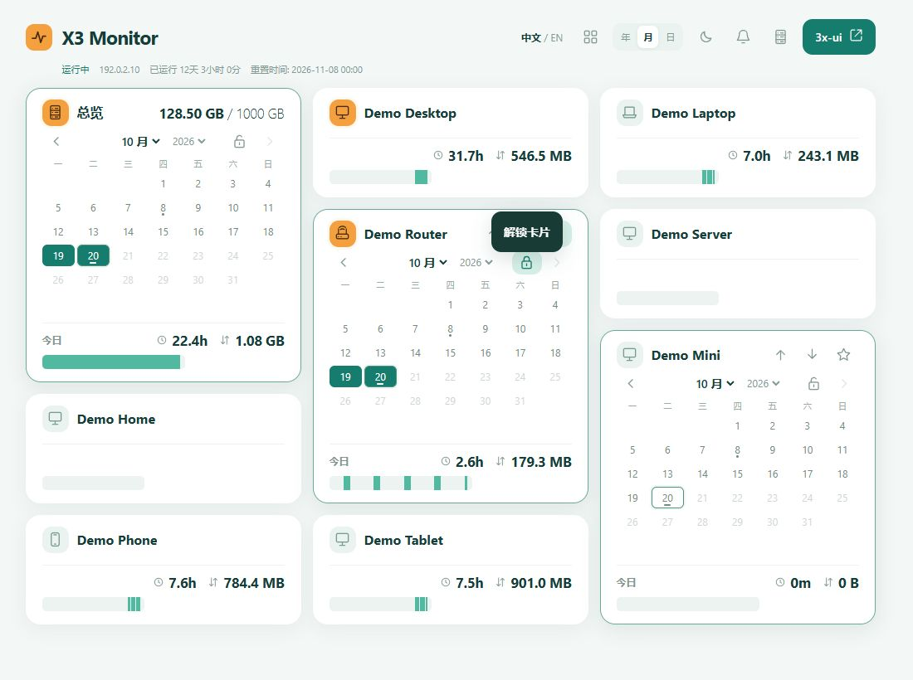

# X3 Monitor

[English](README.en.md)

查看 3x-ui 客户端的活跃时段、使用时长和流量，支持多种服务器与访问方式。



*截图使用示例数据。*

## 功能

- 总览与客户端月历、每日时间轴，悬浮查看时间和流量。
- 客户端排序、设备图标、特别关注和上线通知。
- 中文 / English、深浅主题，适配电脑与手机。
- 查看服务器状态，保留最近一年的记录。
- 可选 BandwagonHost 自动流量统计，或手动设置额度与重置时间。

## 安装

在服务器一键下载并启动中英文安装向导：

```bash
curl -fL https://github.com/siagfried/x3-monitor/archive/refs/tags/v1.1.3.tar.gz -o x3-monitor.tar.gz && tar -xzf x3-monitor.tar.gz && cd x3-monitor-1.1.3 && sudo bash install.sh
```

VEID 和 API Key 在 `install.sh` 执行过程中按提示填写，无需提前修改文件；API Key 隐藏输入。VEID 留空则跳过 API，使用手动流量模式。

也可下载源码后安装：

```bash
git clone https://github.com/siagfried/x3-monitor.git
cd x3-monitor
sudo bash install.sh
```

按提示填写已有 3x-ui 的地址和登录信息，选择访问方式。安装完成后会显示网页入口。

支持 Tailnet、已有 HTTPS 代理、直接 HTTPS 或本机访问。不使用 Tailscale 也可安装；公网访问提供 HTTPS 和登录保护。现有 3x-ui 和订阅配置保持不变。

## 流量设置

**手动模式**：VEID 留空。在网页右上角「系统状态」中修改重置时间、当前已用量和总额度。新的客户端流量会继续累加，每月按设置时间重置。

**BandwagonHost 自动模式**：填写 VEID 和 API Key，自动显示官方用量与重置时间，以及可用的操作、备份和异常记录。

获取方式：[BandwagonHost 客户中心](https://bandwagonhost.com/clientarea.php) → Services → My Services → 对应 VPS → KiwiVM → API，复制 VEID，点击 **Show API Key**。密钥输入不会回显。

手动用量统计面板内的客户端流量，与供应商整机计费可能不同。

## 通知

关注客户端后，点击铃铛开启当前设备的通知。后台接收取决于浏览器及系统设置；本机 HTTP 模式不提供后台通知。

## 更新与卸载

更新源码后再次运行安装脚本，原有设置和记录会保留。

```bash
# 卸载，保留设置和记录
sudo bash /opt/x3-monitor/uninstall.sh

# 完整清理，按提示确认
sudo bash /opt/x3-monitor/uninstall.sh --purge
```

[下载版本](https://github.com/siagfried/x3-monitor/releases) · [验证记录](VALIDATION.md)
